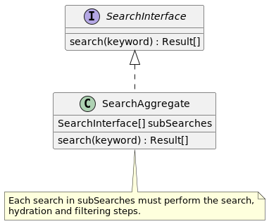
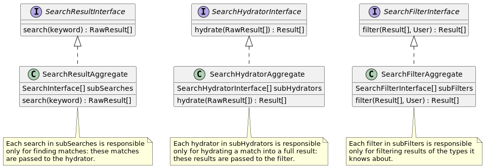

# Search Architecture

* Status: Proposed
* Deciders: Amri Sannang
* Date: 2023-08-01

Technical Story: https://schoolbox.atlassian.net/browse/SA-16011,
https://schoolbox.atlassian.net/browse/SA-16012

## Context and Problem Statement

Search results within Schoolbox may come from multiple different heterogeneous
sources; currently, they are sourced only from database tables (albeit with
inconsistent schemas).

I am aiming to build a search architecture which can support the addition of
multiple sources.

The search architecture has the following responsibilities:
- searching for matches for a search term
- hydrating those matches into fully-realized results
- filtering out matches which the current user is not authorized to view

## Decision Drivers

- Extensibility: would like to easily plug in new search sources
- Authorization: need to ensure that users may only access search results which
  they are permitted to access
- Performance: need to ensure that responses to search requests are performed
  efficiently

## Considered Options

### Single layer

Search results are created by a single object, which is wholly responsible for
the search, hydration and filtering of results.

### Multiple layers

The responsibilities of the search architecture are split across multiple
layers:
- searching for matches returns a set of unhydrated results
- the hydrator is a separate object, which receives unhydrated results and
  returns hydrated results
- the filter is a separate layer

## Decision Outcome

I've chosen the multiple layer option: I believe the possible performance
tradeoff is justified by the ease of extensibility and understanding.

> In practice: the hydration and filter layers have been merged.
>
> This is because the two layers shared too much logic (e.g. whether an object
> in the aggregate hydrator should accept a raw result) to be separated.

## Pros and Cons of the Options

### Single layer

#### Pros
- possible to create a single optimized query which may perform searching, fetch
  and hydration in one step

#### Cons
- difficulty of extensibility
- difficulty of composing an aggregate (for each type of search result) for
  objects with more responsibilities
- complexity of single optimized query

### Multiple layers

#### Pros
- layers are exchangeable: for example, the search layer could be replaced with
  a dedicated search index
- layers may be more easily composed of multiple aggregated sub-parts (e.g.
  separate objects for user and news search)
- easier to reason about each layer's responsibilities, and how it contributes
  to the end search result

#### Cons
- possible slower performance, as more queries will be involved at each layer:
  it is not possible to create a single optimized query
