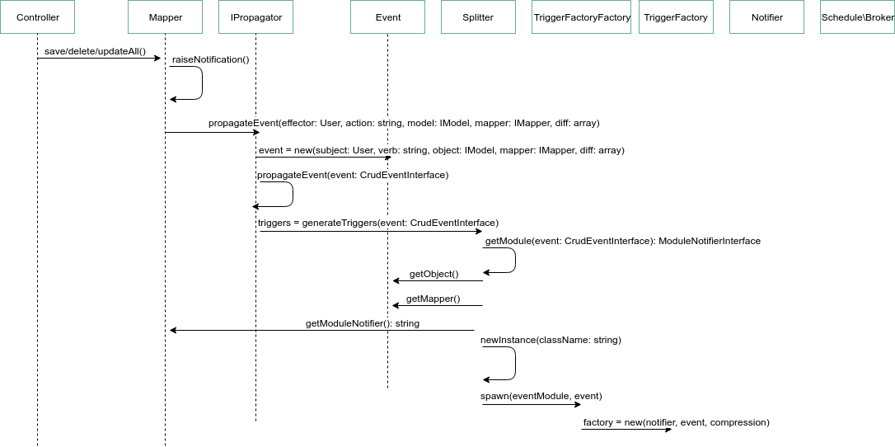

[< Back to Notifications](README.md)

# Propagation

The propagation sub-system is used to generate events within Schoolbox.
These events will then be handled by the scheduling sub-system.

This sub-system is the bridge between synchronous code (i.e. web requests) and
the asynchronous notifications system.

Technically, events may be created by any Schoolbox process; in practise, they
are usually created by mapper actions.

## Sequence Diagram

Source: https://drive.google.com/open?id=1TG40pNKxsKMMK-Ij4GQtBz6Rqh9vlTrI

## Technical Description and Developer Guide

### `Schoolbox\Mapper::save/delete/updateAll`

The mapper data persistence actions are the main point of entry into the
notification creation subsystem.
All of them call `Schoolbox\Mapper::raiseNotification` for each model that was
persisted by this call.

#### Developer Notes

As a developer, you shouldn't have to worry too much about the way that this
works.

#### Known Limitations

`raiseNotification` is currently called immediately after all of the models
passed into `save/delete/updateAll` have been persisted.
This can cause issues because domain-layer objects don't always map one-to-one
to data models.

Example:
* a quiz and its questions form a single atomic domain-layer object but
  multiple data models
* the quiz must be persisted first, as the questions cannot exist without the
  quiz
* the quiz's notifications process immediately on its persistence
* the quiz domain object isn't complete without its questions, therefore the
  notification won't be able to rely upon the content of the questions

This can be worked around by deferring and then manually raising notifications.

### `Schoolbox\Mapper::raiseNotification`

This method sends the current session user, action type (create, update,
delete), model, mapper and difference between previous and current state
(for update actions only) into the mapper's event propagator's `propagate`
method.

#### Developer Notes

This method can be overridden; in practise, it's overridden because this mapper:
* doesn't fire notifications at all
* shouldn't fire notifications until its related objects are also persisted

In this case, this method should simply immediately return `true`.

#### Known Limitations

This method will return without propagating if there is no session user; this
is because mapper-based notifications require an effector to have been set.

This means that notifications won't trigger if a mapper save action occurs in a
CLI script or daemon.

### `\Schoolbox\Realtime\Schedule\Trigger\IPropagator::propagate/propagateEvent`

`propagate` simply marshals the session user, action type, model, mapper and
diff into a `\Schoolbox\Realtime\Schedule\Event\CrudEventInterface` object for
passing into `propagateEvent`.

`propagateEvent` is responsible for the publishing of all triggers into the
scheduling sub-system's message queue. In order to do this, it must first
generate a set of triggers from the event it receives, using
`\Schoolbox\Realtime\Schedule\Event\Splitter::generateTriggers`.

### `\Schoolbox\Realtime\Schedule\Event\Splitter::generateTriggers`

This method determines which notifier module (if any) generates the triggers
for the given event. If it finds a notifier module, it:
* builds a `\Schoolbox\Realtime\Schedule\Trigger\TriggerFactory` instance out
  of the module and event
* calls the trigger factory's `buildTriggers` method
* this in turn calls the notifier module's `bundleTriggers` method to generate
  the set of triggers

#### Developer Notes

In order to generate a trigger for an event, there must be a
`\Schoolbox\Realtime\Schedule\Module\ModuleNotifierInterface` implementation
that is able to be associated with the event.

In practise, this is a sub-class of
`\Schoolbox\Realtime\Schedule\Module\AbstractModuleNotifier` within the same
namespace as the mapper and model class, named either `${namespace}\Notifier`
or `${namespace}\${modelName}Notifier`.

### `\Schoolbox\Realtime\Schedule\Module\ModuleNotifierInterface::bundleTriggers`

Implementations of this method are directly responsible for which triggers are
sent to the scheduling sub-system, and for the time that they are set to
trigger.

The `\Schoolbox\Realtime\Schedule\Trigger\TriggerBundleInterface` object which
this method receives contains the
`\Schoolbox\Realtime\Schedule\Event\CrudEventInterface` object passed into
`\Schoolbox\Realtime\Schedule\Trigger\IPropagator::propagate/propagateEvent`,
and therefore has access to the:
* session user (a.k.a. effector)
* action type
* model
* mapper
* diff

All of these attributes can be used to determine exactly which
`notify${roleType}${trigger}` methods of the notifier get called by the
scheduling sub-system, and when. (Calling these methods is a responsibility of
the scheduling sub-system, and will be documented in its documentation.)

#### Developer Notes

There are two types of actions that can be called on the bundle:
* `attach`: schedules the given trigger type to be called by the scheduler,
  at the given time
  * The time is given as a Unix timestamp, or
    `\Schoolbox\Realtime\Schedule\Module\ModuleNotifierInterface::IMMEDIATELY`
    to schedule it to fire immediately
* `detach`: retracts a previously scheduled trigger type from the scheduler, so
  that it doesn't fire at all
  * Generally, this is used for delete actions; it's usually not appropriate to
    fire notifications for models that have been deleted

#### Known Limitations

`detach` only informs the scheduler that the trigger is to be retracted from
the scheduler; it doesn't pass the message any further.

This can cause issues if the scheduler has already processed an event, and the
router has sent the resultant message to be sent by a non-instant delivery
system (such as the digest, or web-app notifications); the delivery system
doesn't know that the object has been deleted, and will therefore send
notifications that reference deleted objects.

If a notification needs to be retracted from the router completely, it can be
retracted by issuing a retraction in a `notify` method of the notifier.
(This is a responsibility of the scheduling sub-system, and will be documented
there.)

### `\Alaress\Async\Broker\IBroker::publish`

This method pushes the event and its scheduled triggers into the scheduling
sub-system.

At this point, the propagation sub-system's responsibilities are concluded; it
is the scheduling sub-system's responsibility to then queue each trigger and
its events, and call them when their time is reached.

[Scheduling sub-system documentation >](200-scheduling.md)
