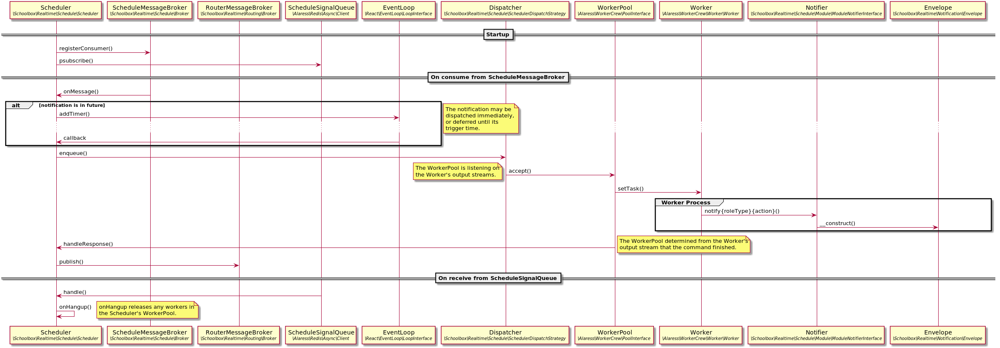

[< Back to Notifications](README.md)

# Scheduling

The scheduling subsystem is used to generate messages from events, and queue
those messages to then be sent to recipients.

This subsystem is the bridge between the [event propagator](100-propagation.md)
and the [message router](300-routing.md).


## Sequence Diagram



Source: [scheduling.plantuml](scheduling.plantuml)


## Technical Description and Developer Guide

### Schedule Daemon

The Schedule daemon (`/tools/mq/scheduled.php`) runs a
`\Schoolbox\Realtime\Schedule\Scheduler` instance as its daemon process.

This class is an instance of the [Scheduler](architecture/scheduler.md); like
all Schedulers, it:
* consumes Triggers from an external source
  * in this case, the scheduling
    [Message Broker](architecture/message-broker.md) as published into by the
    event propagator
* sends the Triggers to its [Dispatcher](architecture/dispatcher.md) to be
  processed
  * in this case, the Trigger is a call to a `notify` method on a
    `\Schoolbox\Realtime\Schedule\Module\ModuleNotifierInterface` instance
* acts as a Response Handler for the response that the Dispatcher returns
  * in this case, it publishes into the routing Message Broker, for the
    [routing sub-system](300-routing.md) to handle


### Notifier

The Schedule Daemon's Scheduler's Trigger is a call to a `notify` method on a
`\Schoolbox\Realtime\Schedule\Module\ModuleNotifierInterface` instance.

These Triggers were generated by
`\Schoolbox\Realtime\Schedule\Module\ModuleNotifierInterface::bundleTriggers`
in the [propagation sub-system](100-propagation.md).

The actual `notify` method that gets called depends on:
* the role type
  * staff
  * student
  * parent
  * system (for events that are not related to a particular role type)
* the trigger label
  * this is a short description of the type of event that occurred

Each `notify` method will return a `Envelope` object; this object contains all
information required for the formation of one or more messages:
* its audience
* its topic (determines how the message is sent to everyone in its audience)
* its title (determines what each audience member actually sees)


#### Example

```php
<?php

use Alaress\Async\Notification\Instance\Builder;
use Schoolbox\Realtime\Notification\Envelope;
use Schoolbox\Realtime\Notification\Parameter\UserParam;
use Schoolbox\Realtime\Schedule\Module\AbstractModuleNotifier;
use Schoolbox\Realtime\Schedule\Trigger\TriggerBundle;
use Schoolbox\User;

class MyNotifier extends AbstractModuleNotifier
{
    private const TRIGGER_CREATED = 'created';
    private const TRIGGER_DELETED = 'deleted';

    public function bundleTriggers(TriggerBundle $bundle): void
    {
        // Often, the triggered notify method depends on the bundle's method.
        switch ($bundle->getMethod()) {
            case \Schoolbox\Mapper::METHOD_CREATE:
                // Trigger the created notify method one day from now
                $bundle->attach(
                    self::TRIGGER_CREATED,
                    Alaress_Date_Format::now()->addDays(1)->getUnixTimeStamp()
                );
                break;

            case \Schoolbox\Mapper::METHOD_DELETE:
                // Trigger the deleted notify method immediately
                $bundle->attach(self::TRIGGER_DELETED, self::IMMEDIATELY);
                break;
        }
    }


    /**
     * This method will be called when the created trigger is fired.
     *
     * It's assumed that this will only build envelopes that are targeted to
     * staff.
     *
     * @param object $object   The object that was just affected
     * @param User   $effector The user who effected the change to the object
     * @param array  $diff     If set, the difference between $object's current
     *                         and previous state
     * @return Envelope
     */
    public function notifyStaffCreated($object, User $effector, array $diff = null): Envelope
    {
        // This method is creating a message to be sent to all staff.
        // There is no equivalent method for students or parents, thus it is
        // assumed that they will not receive a message on this topic.
        $bob = new Builder();
        $bob->setTitle(":user created an object")
            ->setHref('/home/')
            ->addTopic("object.{$object->getId()}.created");

        $bob->setParams([
            'user' => new UserParam($effector),
        ]);

        $envelope = new Envelope();
        $envelope->broadcastToRoleType('staff', $bob->build());
        return $envelope;
    }


    /**
     * This method will be called when the deleted trigger is fired.
     *
     * @param object $object   The object that was just affected
     * @param User   $effector The user who effected the change to the object
     * @param array  $diff     If set, the difference between $object's current
     *                         and previous state
     * @return Envelope
     */
    public function notifySystemDeleted($object, User $effector, array $diff = null): Envelope
    {
        // This method is issuing a retraction for the message sent to all
        // staff above.
        $bob = new Builder();
        $bob->setTitle(":user created an object")
            ->setHref('/home/')
            ->addTopic("object.{$object->getId()}.created");

        $bob->setParams([
            'user' => new UserParam($effector),
        ]);

        $envelope = new Envelope();
        $envelope->retractAllLike($bob->build());
        return $envelope;
    }
}

```

#### Developer Notes

Staff, student and parent `notify` methods are only called if a matching record
for the given trigger label and role type exists in the `msg_source` table.
This is so that end users may control the channel through which they receive
the messages the notify methods generate.

System `notify` methods are always called, regardless of whether the
`msg_source` record exists. This is so that backend actions that must occur may
be processed (for example, the retraction of messages in the routing queue that
correspond to objects that have been deleted).


[< Propagation sub-system documentation](100-propagation.md) |
[Routing sub-system documentation >](300-routing.md)
