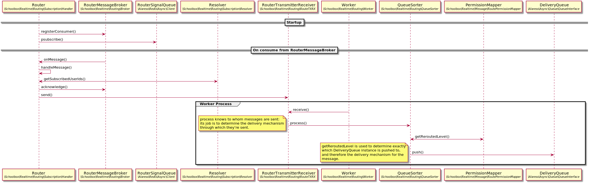

[< Back to Notifications](README.md)

# Routing

The routing subsystem is used to determine to whom, and by which channel(s), a
message is to be delivered.

This subsystem is the bridge between the [scheduling](200-scheduling.md) and
the [delivery](400-delivery.md) subsystems.

## Sequence Diagram

Source: [routing.plantuml](routing.plantuml)

## Technical Description and Developer Guide

### Router Daemon

The Router daemon (`/tools/notif/route/routed.php`) runs a
`\Schoolbox\Realtime\Routing\Subscription\Handler` instance as its daemon
process.

This class is an instance of the [Scheduler](architecture/scheduler.md); like
all Schedulers, it:
* consumes Triggers from an external source
  * in this case, the routing
    [Message Broker](architecture/message-broker.md) as published into by the
    [Scheduling sub-system](200-scheduling.md)
* sends the Triggers to its [Dispatcher](architecture/dispatcher.md) to be
  processed
  * in this case, the Trigger is a call to the Queue Sorter to determine the
    delivery mechanism for the message.
* acts as a Response Handler for the response that the Dispatcher returns
  * the Response Handler responsibility is actually delegated to
    `\Schoolbox\Realtime\Routing\DispatchResponder`; it only outputs the number
    of re-routed messages.

### Resolver

The router uses a [Resolver](architecture/resolver.md) to determine to whom a
message is delivered; it translates the message's topic into an intended
audience.

### Queue Sorter

Once the Resolver has determined the audience of a message, the Queue Sorter
determines the mechanism via which the message is delivered.

It queries the database to determine the configured delivery mechanisms for
that message topic, and then adds the message to the queue for the appropriate
sub-section of the [delivery sub-system](400-delivery.md).

[< Scheduling sub-system documentation](200-scheduling.md) |
[Delivery sub-system documentation >](400-delivery.md)
