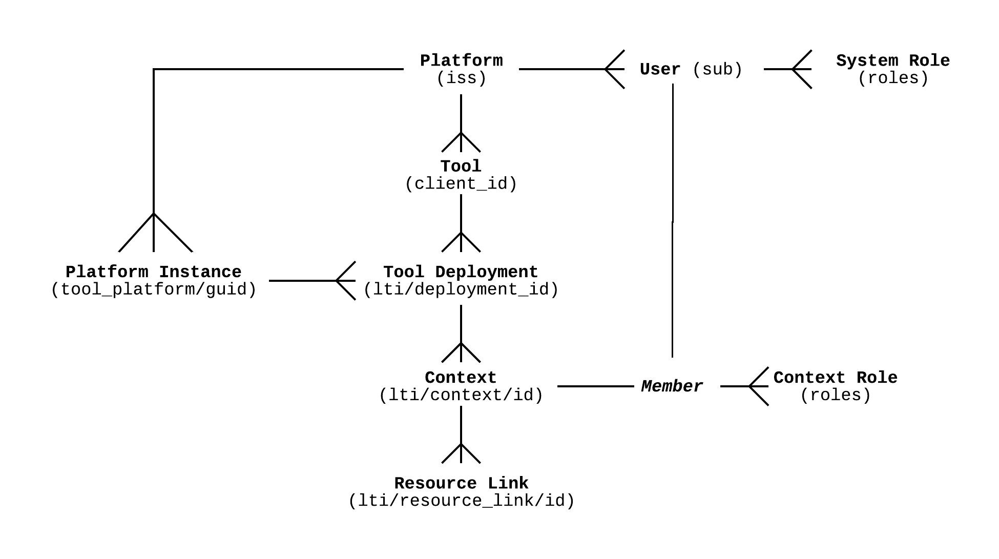

# LTI Domain Model Overview

From https://www.imsglobal.org/spec/lti/v1p3/#lti-domain-model:

# LTI Domain Model Objects

## Platform

### Definition

From https://www.imsglobal.org/spec/lti/v1p3/#platforms-and-tools:

> A tool platform or, more simply, platform has traditionally been a Learning
> Management Systems (LMS), but it may be any kind of platform that needs to
> delegate bits of functionality out to a suite of tools.

### In JWTs

This is the `iss` (issuer) claim in JWTs sent from the Schoolbox platform
(see https://datatracker.ietf.org/doc/html/rfc7519#section-4.1.1).

### In this integration

This value is the fully-qualified domain name (FQDN) of the Schoolbox instance
(e.g. https://vagrant.dev.schoolbox.cloud).

> An alternative considered for this value was to set this as the FQDN of
> Schoolbox itself (`https://schoolbox.com.au`).
>
> This alternative was rejected, because the User claim would need to uniquely
> identify a user across all Schoolbox instances, not just the issuing instance.

## User

### Definition

From https://www.imsglobal.org/spec/lti/v1p3/#users-and-roles:

> An object representing a person with a current session within the platform and
> provided to the tool.
>
> A user MUST have a unique identifier within the platform, which acts as an
> OpenId Provider.
>
> Typical properties such as a first name, last name, and email address, MAY be
> shared with a tool.
>
> A tool or platform MUST NOT use any other attribute other than the unique
> identifier to identify a user when interacting between tool and platform.

### In JWTs

This is the `sub` (subject) claim in JWTs sent from the Schoolbox platform
(see https://datatracker.ietf.org/doc/html/rfc7519#section-4.1.2).

### In this integration

Since this value must uniquely identify a user within the Schoolbox platform,
this will be the username of the currently authenticated Schoolbox user.

## User roles

### Definition

From https://www.imsglobal.org/spec/lti/v1p3/#users-and-roles:

> The role represents the level of privilege a user has been given within the
> context hosted by the platform.
>
> Typical roles are "learner", "instructor", and "administrator".
>
> Note that it's entirely possible that a user might have a different role in a
> different context (a user that is a "student" in one context may be an
> "instructor" in another, for example).
>
> Tools may, in turn, use the role to determine the level of access they may
> give to a user.

### In JWTs

This is the `https://purl.imsglobal.org/spec/lti/claim/roles` optional custom
claim within JWTs sent from the Schoolbox platform
(see https://www.imsglobal.org/spec/lti/v1p3/#roles-claim).

### In this integration

This value may be used by the tool to determine the access rights the user has
to content within the tool.

Whilst user roles will be context-dependent, it is likely that:
* Teachers will have a `http://purl.imsglobal.org/vocab/lis/v2/institution/person#Instructor`
  user role
* Students will have a `http://purl.imsglobal.org/vocab/lis/v2/institution/person#Learner`
  user role

## Platform Instance

### Definition

From https://www.imsglobal.org/spec/lti/v1p3/#platform-instance-claim:

> This claim composes properties associated with the platform instance
> initiating the launch.

### In JWTs

This is the `https://purl.imsglobal.org/spec/lti/claim/tool_platform` optional
custom claim within JWTs sent from the Schoolbox platform
(see https://www.imsglobal.org/spec/lti/v1p3/#platform-instance-claim).

### In this integration

This claim will contain information about the Schoolbox instance, and also
about Schoolbox itself.

It will contain this set of keys/values:
* `guid`: the instance ID of the Schoolbox instance, or config `site_school_code`
* `contact_email`: likely blank
* `description`: likely blank
* `name`: blank, or config `title`
* `url`: the instance's FQDN (in effect, the same as the Platform value)
* `product_family_code`: likely "schoolbox"
* `version`: config `site_version`

## Tool

### Definition

From https://www.imsglobal.org/spec/lti/v1p3/#platforms-and-tools:

> The external application or service providing functionality to the platform is
> called a tool.
>
> Examples of tools might include an externally hosted testing system or a
> server that contains externally hosted premium content.

### In JWTs

This is the `aud` claim in JWTs sent from the Schoolbox platform
(see https://datatracker.ietf.org/doc/html/rfc7519#section-4.1.3).

> Confusingly: within the LTI domain model this is referred to as a `client_id`,
> even though there is neither a private, public nor LTI custom claim with this
> name.

### In this integration

This value is a unique identifier, and will be provided by the LTI tool.

When configuring the deployment of a tool within a Schoolbox instance, this
value must be provided.

## Tool Deployment

### Definition

From https://www.imsglobal.org/spec/lti/v1p3/#tool-deployment:

> A deployment of a tool defines the scope of contexts under which a tool is
> made available.
>
> For example, a tool may be deployed by the instructor into a single course, or
> the institution may deploy a tool across the whole institution, available to
> all institution's contexts, present and future.

### In JWTs

This is the `https://purl.imsglobal.org/spec/lti/claim/deployment_id` custom
claim (see https://www.imsglobal.org/spec/lti/v1p3/#lti-deployment-id-claim).

### In this integration

There will only be a single tool deployment per tool; at the time of message
generation, a context will be provided.

The specification for tool deployments states that this value must be generated
by the platform at deployment time; therefore, Schoolbox generates a UUID as a
deployment ID at the time the tool is configured.

## Context

### Definition

From https://www.imsglobal.org/spec/lti/v1p3/#contexts-and-resources:

> LTI uses the term context where you might expect to see the word "course".
>
> A context is roughly equivalent to a course, project, or other collection of
> resources with a common set of users and roles.
>
> LTI uses the word "context" instead of "course" because a course is only one
> kind of context (another type could be "group" or "section").

### In JWTs

This is the `https://purl.imsglobal.org/spec/lti/claim/context` optional custom
claim within JWTs sent from the Schoolbox platform
(see https://www.imsglobal.org/spec/lti/v1p3/#context-claim).

### In this integration

Schoolbox interprets a "context" as the place whence an LTI resource link is
launched.

Schoolbox will use this context to determine the current user's access rights
before launching the LTI resource link.

For deep linking requests (used to fetch content from the LTI tool to link to
Schoolbox):
* `id`: the assessment's folder's ID, prefixed to specify that it's a folder
* `type`: unsure; possibly:
  * blank (this field is optional)
  * `http://purl.imsglobal.org/vocab/lis/v2/course#CourseTemplate` for
    assessments being created within a course specification
  * `http://purl.imsglobal.org/vocab/lis/v2/course#CourseSection` for
    assessments being created outside of a course specification
* `label`: blank, or the folder's codes
* `title`: the folder's name

For resource link launch requests (used to send a student from Schoolbox to the
assessment within the LTI tool):
* `id`: the assessment's ID, prefixed to specify that it's an assessment
* `type`: unsure; possibly:
    * blank (this field is optional)
    * `http://purl.imsglobal.org/vocab/lis/v2/course#Group`
* `label`: blank, or the folder's codes
* `title`: the folder's name

## Resource Link

### Definition

From https://www.imsglobal.org/spec/lti/v1p3/#contexts-and-resources:

> Typically, within a context, users can integrate many LTI content items, or
> resources, sometimes arranging them into folders like "Week 1" or "Pre-Work".
>
> Conceptually, these platform integrations serve the same general purpose as
> any other type of item within the structure of a context's available content.
>
> In particular, commonly, users may scatter multiple LTI links through the
> content structure for a context that is linked to a particular resource. A
> platform MUST distinguish between each of these LTI links by assigning a
> resource_link_id to an LTI Link.

### In JWTs

This is the `https://purl.imsglobal.org/spec/lti/claim/resource_link` optional
custom claim within JWTs sent from the Schoolbox platform
(see https://www.imsglobal.org/spec/lti/v1p3/#resource-link-claim).

Resource link launch requests will also contain the
`https://purl.imsglobal.org/spec/lti/claim/target_link_uri` claim, as the URL to
redirect to once the resource link launch is processed and approved
(see https://www.imsglobal.org/spec/lti/v1p3/#target-link-uri).

### In this integration

Resource link launch requests from a Schoolbox assessment will contain this
claim, with the following values:
* `id`: the assessment's ID
* `description`: blank, or the assessment's description
* `title`: the assessment's title
