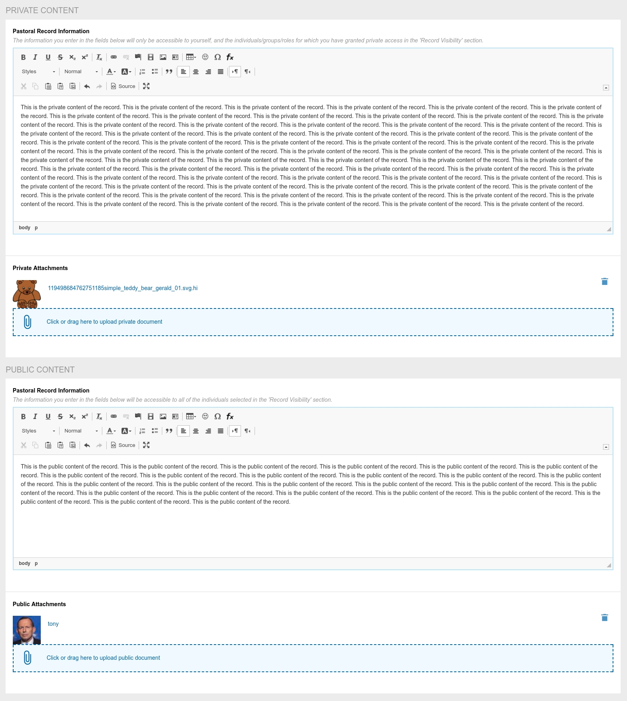
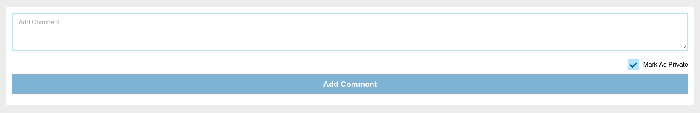
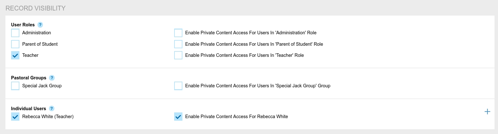
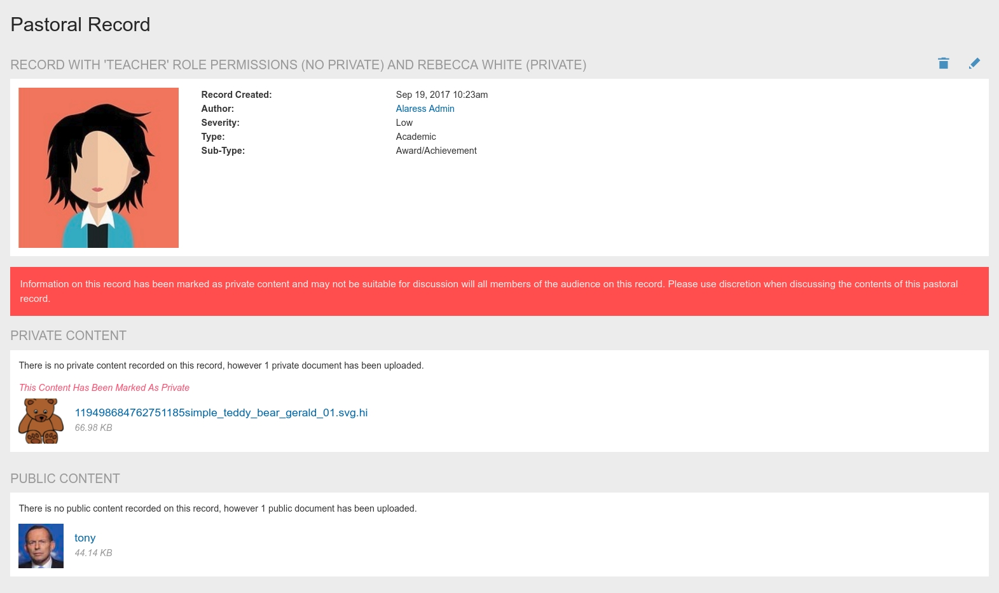
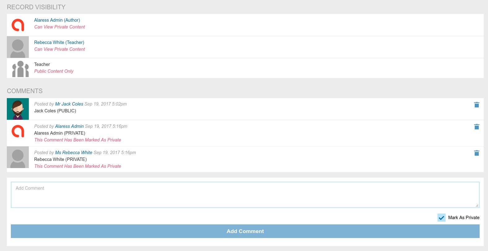

# Pastoral Care Private/Public Content

[Back](./README.MD)

## What Is Public/Private Content

This version introduces the concept of a separate **public body** and **private body** on each pastoral record. 

This is in line with the existing behaviour of Synergetic's pastoral care system.

As part of this change, it is now also possible to upload **public attachments** and **private attachments** to
each pastoral record.

It is also possible for audience members to post **public comments** and **private comments** by toggling the checkbox
underneath the comment field.

During the upgrade, if a pastoral care record had the **private** flag set (from the V16.0 pastoral permissions system)
then the content of the pastoral record will be moved into the **private body**. If this was not set then content will
be moved into the **public body**.

### Who Can See Public/Private Content 

#### Private Content

The following individuals can see the private content on a record

* All pastoral moderators
* The original author of the record
* Any audience member listed on the record that has the 'Private' permission checkbox ticked.

#### Public Content

The following individuals can see the public content on a record

* All pastoral moderators
* The original author of the record
* Any audience member listed on the record

#### If I Don't Have Access To Private Content...

You will not see it. You will only see the public content.

#### If I Do Have Access To Private Content...

You will receive a red message warning you that some content on the page is private, and advised to use discretion
when commenting on the record.

You will also see the access of all audience members, and a red label on every comment that has been marked as private. 

#### What About Parents/Students/Guests?

* Users in the student/guest roles have no access to any part of the pastoral care system
* Parents will only be able to view records if they have been specifically listed in the audience of the record
* When authoring a pastoral care record it is not possible to add the parents of a different student to the record 
