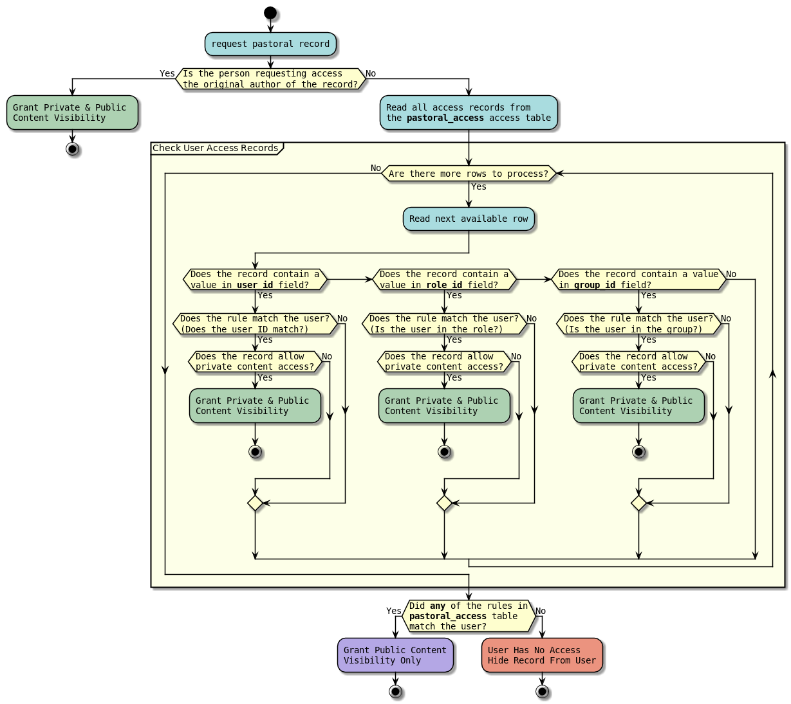

# Pastoral Care Record Visiblity

[Back](./README.MD)

## Who Can See A Pastoral Record Exists?

The following diagram explains the record visibility logic

In order for a person to see a pastoral record exists, they meet one of the following criteria.

* Be the author of the pastoral record
* Be listed in the audience defined by the author of the record
* Be a pastoral moderator

If none of these conditions is met, the user should have absolutely no visibility of the records existence (i.e. it will
appear as if it was deleted or never existed).

## Special Cases

#### Superusers

They're not special in pastoral at all. They have no special visibility or access to records via the user-interface. 

It is important to note however that they are able to make themselves a pastoral moderator* so the point is slightly 
moot, and schools should already be aware they could just go into the database and read it directly anyway.

#### Pastoral Moderators

Pastoral moderators bypass all audience permissions on records. These users have access to view every record in
the pastoral system regardless of an authors assigned permissions.

There are three levels of pastoral moderator permission that can be set on the Modify User screen.

> ##### Read Permission
> 
> Read pastoral moderators can read all pastoral records. They cannot however make any changes to the records unless
> they were the original author.
> 
> ##### Write Permission
> 
> Write pastoral moderators can read and update the content of all pastoral records. They cannot delete any records
> unless they were the original author.
> 
> ##### Moderate Permission
> 
> Moderate pastoral moderators have full read/modify/delete permissions on all pastoral records. They have the same
> effective permissions as the original author of the record.