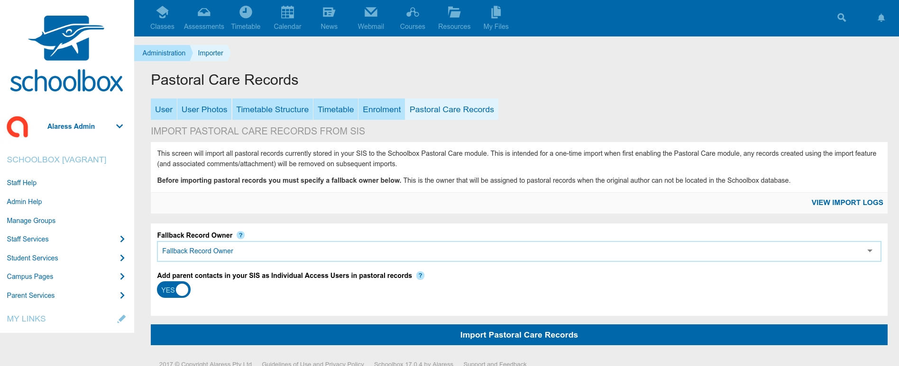

# Pastoral Care External SIS Import Log

[Back](../README.MD)

## Links

[Schema Documentation](./README_SCHEMA.MD)  

## TLDR

This mapper/model is a lazy way of logging pastoral care imports from Synergetic (and potentially later, other SIS
products). Importing is initiated from the Admin section of Schoolbox, and the logs are visible once the import
is started.

 

The table contains a list of records that the system attempted to import, along with the result of the 
import (success/failure).

During an import many records will fail to import, this is usually due to the students not existing in Schoolbox
(past students), and is generally considered normal. If a current student is not importing it is typically due to
their user record in Schoolbox not having the correct External SIS ID associated with it.