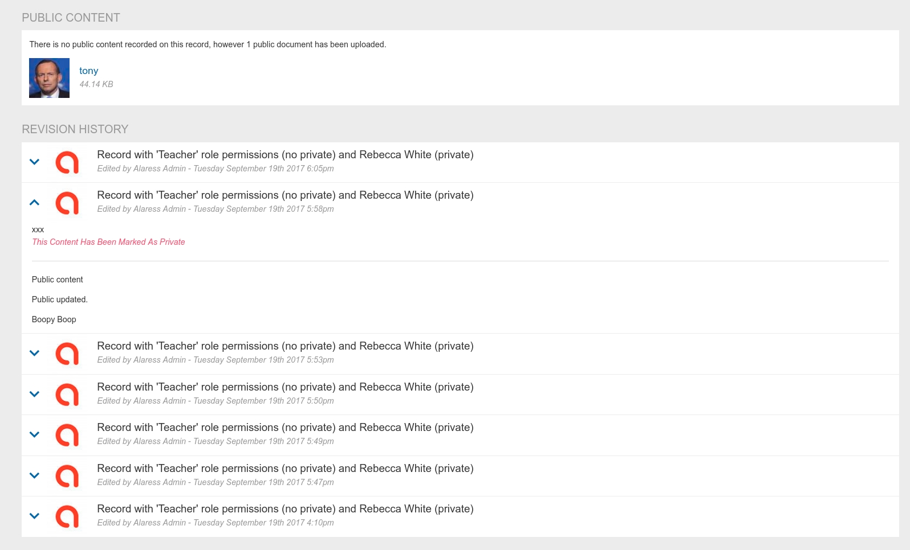

# Pastoral Record Revision History

[Back](../README.MD)

## Links

[Schema Documentation](./README_SCHEMA.MD)  

## TLDR

Every time a pastoral record is created/updated/deleted a copy of the record is made in the 'pastoral_revision' table
for posterity. 

Pastoral moderators can view a limited subset of this information when they open a pastoral record. 

