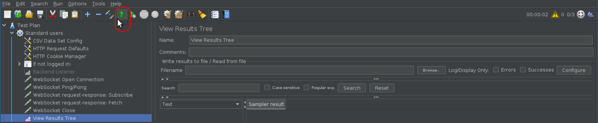
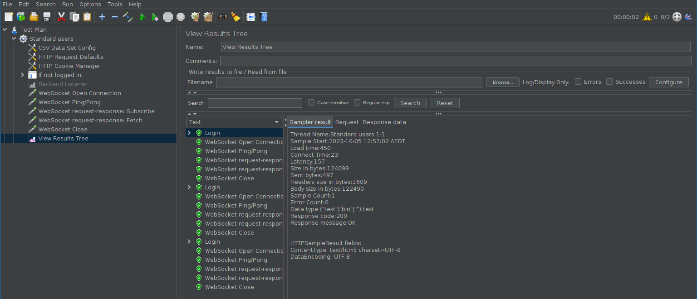

# Schoolbox Load Testing

Schoolbox load tests currently uses:
- [Apache JMeter](https://jmeter.apache.org/) for websocket load testing
- [k6](https://k6.io/) for HTTP/page load testing (see the k6 subdirectory's `README.md` for more information)

## Getting Started

### Installing JMeter

Download the latest JMeter from https://jmeter.apache.org/download_jmeter.cgi,
and extract to a folder somewhere (from now on, this folder will be referred to
as `$JMETER_DIR`).

### Installing required JMeter plugins

The websocket test uses the plugin "WebSocket Samplers by Peter Doornbosch" for
testing websocket connections.

> Why not the other websocket plugin (WebSocket Sampler by Maciej Zaleski)?
>
> I tested that plugin, and I couldn't get it to pass cookies in websocket
> requests.

#### Installing via the plugins manager

Download the JMeter Plugins Manager plugin from
https://jmeter-plugins.org/wiki/PluginsManager/ (direct link:
https://jmeter-plugins.org/get/), and copy the downloaded .jar file into the
`$JMETER_DIR/lib/ext` directory.

Start JMeter by executing `$JMETER_DIR/bin/jmeter` (either in an explorer
window or command line).

Select the "Options > Plugins Manager" menu option: this will open the plugins
manager.

Under "Available Plugins": search for "websocket", then select and install
"WebSocket Samplers by Peter Doornbosch"

#### Manual installation

The plugin can be downloaded directly from
https://bitbucket.org/pjtr/jmeter-websocket-samplers/downloads/: simply download
the latest version, and copy it into the `$JMETER_DIR/lib/ext` directory.

## Configuring load test

Create file `$SCHOOLBOX_DIR/test/load/websocket/users.csv`, and enter a valid
username+password combination for https://vagrant.dev.schoolbox.cloud/,
separated by a comma; e.g.:

```
myUsername,myPassword
```

> This file is created so that passwords are not hardcoded within the JMeter
> test itself.

## Modifying load test

Open the JMeter desktop application:
```shell
$JMETER_DIR/bin/jmeter \
  -t $SCHOOLBOX_DIR/test/load/websocket/websocket.jmx
```

You may test the load test by running the Start action:


After that, a log of the results will display in the Results Tree node of the
test plan:


## Running load test

From a command line (i.e. _not_ within JMeter):
```shell
$JMETER_DIR/bin/jmeter -n \
  -t $SCHOOLBOX_DIR/test/load/websocket/websocket.jmx \
  -l log.jtl
```

### Customizing the run

The test allows the following properties to be overridden on invocation, with
the `-J${property}` command-line option:

| Property | Meaning                                                                     | Default                     |
|----------|-----------------------------------------------------------------------------|-----------------------------|
| `users`  | The number of websocket connections to create simultaneously                | 3                           |
| `rampUp` | The ramp-up period (how many seconds until `users` connections are created) | 3                           |
| `host`   | The host to run the load test against                                       | vagrant.dev.schoolbox.cloud |

For example, to run the test with 10000 simultaneous users, ramping up over 3
minutes, against alpha.dev.schoolbox.cloud:
```shell
$JMETER_DIR/bin/jmeter -n \
  -t $SCHOOLBOX_DIR/test/load/websocket/websocket.jmx \
  -l log.jtl \
  -Jusers=10000 \
  -JrampUp=180 \
  -Jhost=alpha.dev.schoolbox.cloud
```
